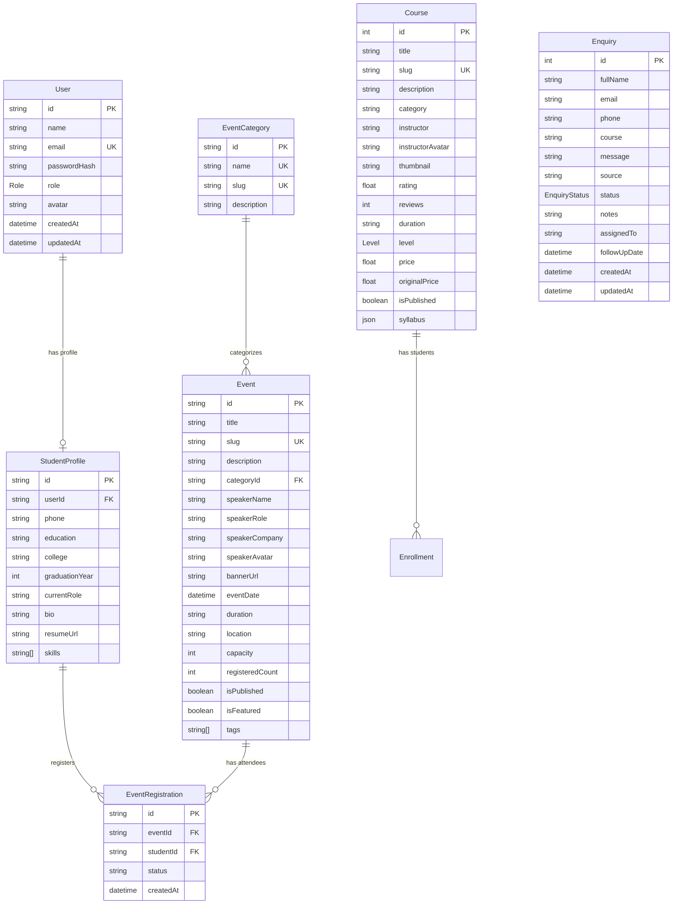

# CareerCatch — Centralized Database Schema

Database: **PostgreSQL**  
ORM: **Prisma Client v6.19.3**  
Location: [server/prisma/schema.prisma](file:///home/guru/Documents/IBT-TECH/on-going/Career%20Catch/career-catch/server/prisma/schema.prisma)

---

## 1. Entity Relationship Overview

---

## 2. Core Tables & Enums

### Role Enum
- `SUPER_ADMIN`: Root operations management.
- `ADMIN`: Content & workshop operations.
- `EDITOR`: Syllabus & workshop contributor.
- `STUDENT`: Public registered student learner.

### EnquiryStatus Enum
- `NEW`: Fresh inquiry from website lead forms.
- `CONTACTED`: Senior advisor made initial outreach.
- `INTERESTED`: Candidate evaluated curriculum.
- `ENROLLED`: Completed registration.
- `FOLLOW_UP`: Re-schedule requested.
- `NOT_INTERESTED`: Disqualified lead.

### Content Models
- `Category`: Domain tracks (Full Stack, Cloud, AI).
- `Technology`: Modern tech stack (React, Next.js, AWS, Kafka).
- `Mentor`: Industry mentors with credentials.
- `Testimonial`: Verified alumni reviews with salary hike percentages.
- `FAQ`: Categorized common questions.
- `Project`: Real-world portfolio capstones.
- `HiringPartner`: Hiring partner logos and partner tiers.
